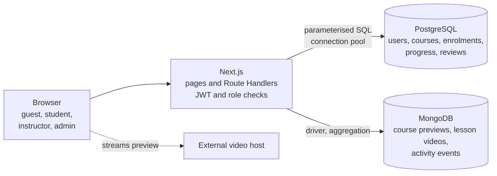
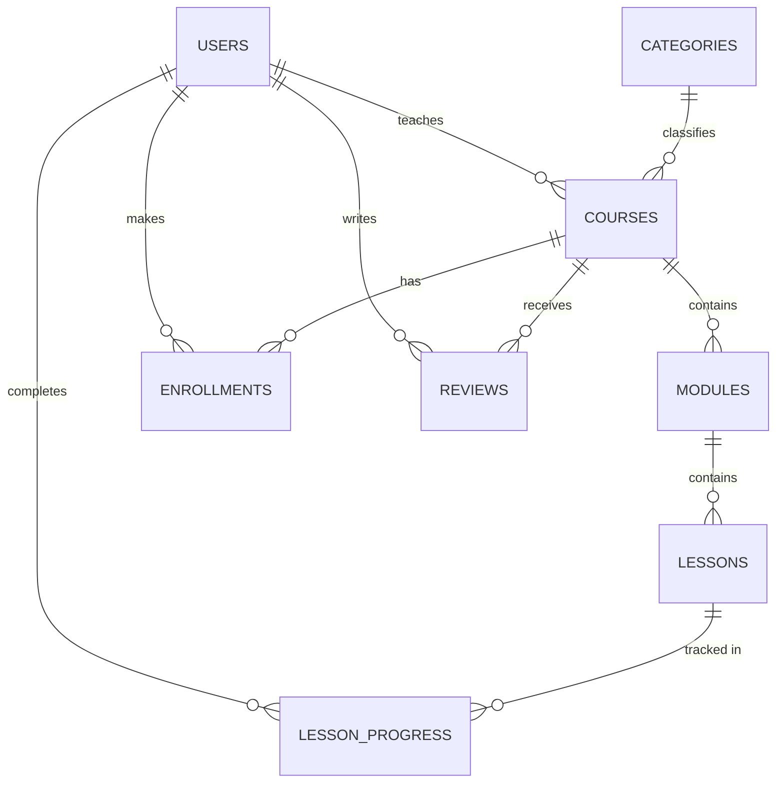

# Mini-Udemy 

A learning platform where **PostgreSQL guarantees student progress** and **MongoDB records learner behaviour**, so instructors can see where students get stuck.

Built with Next.js 15 (App Router), PostgreSQL and MongoDB as a DBMS Level 3 course project at PES University.

## The problem

Online courses are long, and many students stop midway. A learning platform has to:

1. record exactly which lessons each student has finished,
2. keep that record correct when many people use the system at the same time, and
3. show instructors where students stop.

Mini-Udemy keeps records that must always be correct in PostgreSQL, enforced by constraints and triggers inside the database. It keeps flexible, high-volume behaviour data in MongoDB, and combines the two to explain learner behaviour.

## Features

| Role | What they can do |
|---|---|
| **Guest** | Browse the catalogue, search by keyword, filter by category and level, watch a course's preview video, read reviews |
| **Student** | Register, enrol, open a lesson to watch its video, mark it complete, track progress in My Learning, review a course after finishing at least 50% of it |
| **Instructor** | See their courses' enrolments, average progress and ratings; publish a new course with its modules and lessons; edit its preview video; delete a course nobody is enrolled in; see learner insights |
| **Admin** | Everything an instructor sees for all courses, plus 7 SQL reports and a watch-time report as tables and charts, and user management (search users, change roles) |

### What makes it different

| Feature | How it works |
|---|---|
| **Lesson stall detector** | Compares students who *opened* each lesson (MongoDB) with those who *completed* it (PostgreSQL). A large gap points to a lesson students give up on. |
| **Preview-to-enrolment conversion** | Counts preview sessions per course (MongoDB) and how many of those viewers enrolled (PostgreSQL). |
| **At-risk learner detection** | Flags active students below 100% with no learning activity for 14 days. |
| **Progress-verified reviews** | A database trigger rejects a review unless the student has completed at least 50% of the course, so no route can skip the rule. |

## Architecture



The browser never talks to a database. Route Handlers verify the session cookie, read the user's current role from PostgreSQL, and then query the databases. **PostgreSQL is the source of truth**: MongoDB never decides whether a student is enrolled or finished, so if MongoDB is down, progress, reviews and SQL reports still work.

## Database design

### PostgreSQL: 8 tables in third normal form



`enrollments`, `lesson_progress` and `reviews` resolve the many-to-many relationships between students, courses and lessons, each with a unique pair so nothing can be duplicated. The completion percentage is calculated, not stored, so it can never disagree with the progress rows.

| Feature | Where it is used |
|---|---|
| **Constraints** | Primary and foreign keys, `UNIQUE`, `NOT NULL`, `CHECK` (email format, price, level, rating 1 to 5); `CASCADE` for course structure, `RESTRICT` so a course with students cannot be deleted |
| **Triggers** | Course owner must be an instructor; progress needs an enrolment; status becomes completed at 100% (with a `FOR UPDATE` row lock for simultaneous requests); a review needs 50% progress |
| **Functions** | `course_completion_pct()` and `enroll_student()` (safe to repeat thanks to `ON CONFLICT`) |
| **View** | `v_student_progress`, used by My Learning, reports and insights |
| **Transaction** | Publishing a course inserts the course, its modules and lessons together, or nothing at all |
| **Indexes** | Foreign-key indexes and a GIN full-text index on course title and description |

The full schema is in [`schema.sql`](schema.sql). It includes `CREATE`, `ALTER` and `DROP`.

### MongoDB: 3 collections

| Collection | Contents | Why MongoDB |
|---|---|---|
| `course_previews` | One document per course: video link, tags, what you will learn | Fields and list lengths differ by course; read whole by `course_id`; checked by a `$jsonSchema` validator |
| `lesson_videos` | One document per lesson: video link and the second it starts from | Content, not a record that must be correct; read by `lesson_id` when a lesson is opened; validated, one per lesson. PostgreSQL decides who may watch (enrolled student, owning instructor or admin) |
| `activity_events` | Preview plays, lesson opens, pauses and completions with watch time | Many small append-only records whose fields vary by type; summarised with aggregation pipelines |

Before an event is stored, the API checks in PostgreSQL that the course exists and that the lesson belongs to it. Video files are stored in neither database; only the link is kept. Each course's lessons play one full-length public tutorial on its topic, each lesson starting at a different point in it.

## Getting started

### Requirements

- Node.js 20 or newer
- PostgreSQL (local or Docker) and MongoDB (local or Atlas)

### Setup

```bash
git clone https://github.com/reddyritesh33-bit/mini-udemy.git
cd mini-udemy
npm install
cp .env.example .env.local      # then fill in your database details and a JWT secret
```

Create a database called `miniudemy` and load the schema. With PostgreSQL in Docker:

```bash
docker run -d --name miniudemy-pg -e POSTGRES_PASSWORD=postgres -e POSTGRES_DB=miniudemy -p 5432:5432 postgres:18
docker cp schema.sql miniudemy-pg:/schema.sql
docker exec miniudemy-pg psql -U postgres -d miniudemy -f /schema.sql
```

Or with a local PostgreSQL: `psql "$DATABASE_URL" -f schema.sql`. Loading `schema.sql` drops all tables first, so use it only on a new or disposable database. If you have a database from an older version, run `migrations/001_trigger1_for_share.sql` instead; it keeps your data.

Then set up MongoDB, add demo data and start the app:

```bash
npm run setup:mongo    # collections, validators and indexes
npm run seed           # demo users, 10 courses, previews, lesson videos and activity (safe to run again)
npm run dev            # http://localhost:3000
```

### Demo accounts

All seeded accounts use the development-only password `Password123!`.

| Role | Email |
|---|---|
| Admin | `admin@miniudemy.test` |
| Instructor | `asha@miniudemy.test`, `vikram@miniudemy.test` |
| Student | `student1@miniudemy.test` to `student20@miniudemy.test` |

Students 1 to 5 start with no activity, for live demos. Students 6 to 19 hold the generated activity used by the reports and insights. Student 20 is reserved for the concurrency test.

## Testing

The test suites write and delete data, so they run against **separate test databases** whose names must contain `test`. Copy `.env.test.example` to `.env.test` and point it at, for example, `miniudemy_test`.

| Command | What it checks |
|---|---|
| `npm run test:db` | 34 database checks: constraints, triggers, functions, view, transaction rollback, 20 simultaneous enrolments, simultaneous last lessons (with a control run that shows the row lock is needed), the 7 reports, the GIN index, MongoDB validation and aggregation, and the three insight queries. Reloads `schema.sql` itself. |
| `npm run test:api` | 114 API checks against the running app: every route, wrong-role access, reviews and the 50% rule, lesson video access, the publish transaction (including a failure on the last lesson), course delete across both databases, insights, reports and user management |
| `python tests/browser_test.py` | 29 browser checks as guest, student, instructor and admin, including lesson videos (needs `pip install playwright` and `playwright install chromium`) |
| `npm run test:concurrency` | 20 parallel enrolment requests through the app produce exactly one row |

For the API and browser tests, load `schema.sql` into the test database, run `npm run setup:mongo` and `npm run seed` against it, and start the app with the same database settings as `.env.test`.

## API

| Method | Route | Who | Purpose |
|---|---|---|---|
| POST | `/api/auth/register` | anyone | Create a student account |
| POST | `/api/auth/login`, `/api/auth/logout` | anyone | Start or end a session (JWT in an httpOnly cookie) |
| GET | `/api/auth/me` | logged in | Current user, with the role read fresh from the database |
| GET | `/api/courses` | anyone | Catalogue with full-text search and filters |
| GET, DELETE | `/api/courses/:id` | anyone reads; owning instructor or admin deletes | Course with its structure and the caller's progress |
| POST | `/api/courses/:id/enroll` | student | Enrol |
| GET, POST, PUT, DELETE | `/api/courses/:id/reviews` | anyone reads; student writes; admin removes | Reviews with the 50% rule |
| GET, PUT | `/api/courses/:id/preview` | anyone reads; owning instructor or admin edits | Preview video (MongoDB) |
| POST | `/api/lessons/:id/complete` | student | Complete a lesson |
| GET | `/api/lessons/:id/video` | enrolled student, owning instructor, admin | The lesson's video (MongoDB) |
| GET | `/api/me/learning` | student | Progress in every enrolled course |
| POST | `/api/events` | anyone for preview plays; logged in for lesson events | Record activity |
| GET, POST | `/api/instructor/courses` | instructor (admin reads all) | Course figures; publish a course |
| GET | `/api/insights` | instructor, admin | Stalled lessons, conversion, at-risk learners |
| GET | `/api/admin/reports`, `/api/admin/reports/watch-time` | admin | 7 SQL reports; MongoDB watch time |
| GET, PATCH | `/api/admin/users`, `/api/admin/users/:id` | admin | List users; change a role |

## Known limitations

- Lesson videos are embedded from YouTube, so the app cannot see playback; watch time measures how long a lesson stayed open.
- The page requires a student to open a lesson before marking it complete, but a direct API call does not.
- Preview conversion links logged-in viewers only, so it is a lower estimate.
- Deleting a course removes its MongoDB documents after the PostgreSQL delete; there is no shared transaction, so a failed cleanup leaves orphan documents, which reports ignore.
- The demo data is generated, not real student behaviour. Preview and lesson videos are public tutorials by other creators (mostly freeCodeCamp), linked rather than hosted.

## Team

- Bandugula Sai Rithesh Reddy ([@reddyritesh33-bit](https://github.com/reddyritesh33-bit))
- Santhosh ([@Balla-Santhosh](https://github.com/Balla-Santhosh))
